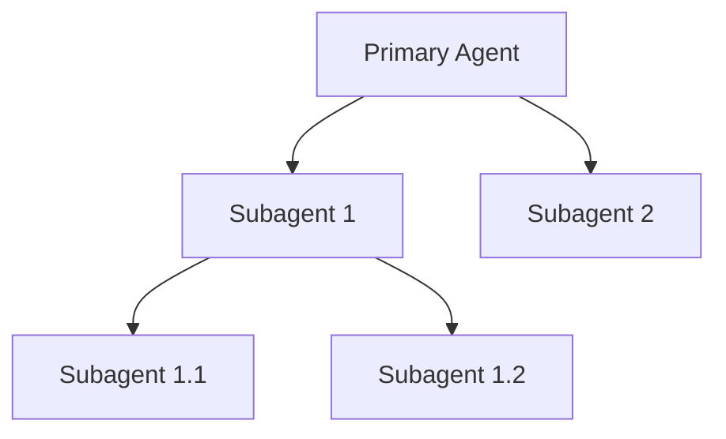
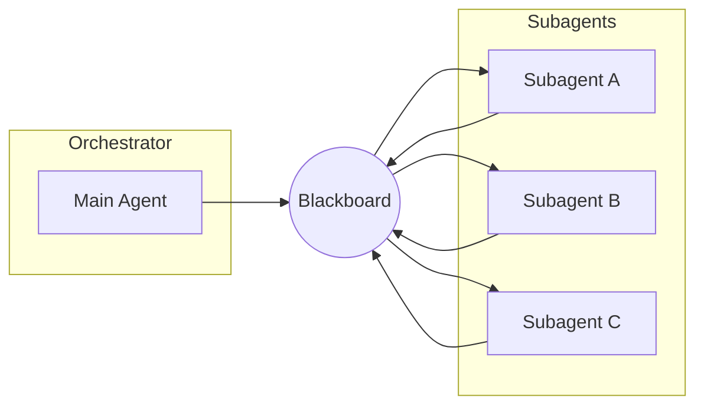

# Executive Summary

Multi-agent AI systems use **subagents** – auxiliary agents spawned by a primary agent – to decompose and solve complex tasks.  Subagents operate with isolated contexts, performing specialized subtasks in parallel or sequence under the orchestration of a main agent.  This report surveys the state of the art (2023–2026) in designing and using subagents. We clarify terms and taxonomy, review architectural patterns (hierarchical chains, blackboard/shared memory, pipeline/task graphs, peer networks), and illustrate them with **Mermaid** diagrams.  We distill best practices for **prompt design** – e.g. “fresh-eyes” instructions, clear task schemas (JSON/YAML), error-handling and security constraints, and strategies for passing context or state – supported by concrete examples.  Key **evaluation metrics** (functional correctness, robustness, consistency vs. best-of-\(k\) performance, resilience to adversarial prompts) and testing strategies (unit tests, CI gating with calibrated judges) are discussed. We survey prominent open-source agentic frameworks and projects (e.g. LangChain/LangGraph, CrewAI, AutoGen, code-review bots) in a comparison table (name, type, language, license, link, maturity).  Leading academic works (arXiv, ACL, NeurIPS, etc.) and industrial cases are highlighted. For example, *AutoGen* (Wu et al., 2023) provides a multi-agent conversation framework, and *CyberLLM* (Li et al., 2024) defines a two-stage detector/decision pipeline for automotive cybersecurity.  Use cases in software development (automated code review, CI/CD assistants) and cybersecurity (incident investigation, threat detection) are illustrated. We catalog **risks** (prompt injection, information leaks, privilege escalation) and mitigations (context verification, manifest signing, provenance labels). Finally, we recommend tools and deployment patterns (e.g. agent frameworks like LangGraph and CrewAI, containerized services, monitoring), and identify open problems and future directions (multi-agent trust, scalable memory, formal verification of agent chains).

## Definitions and Taxonomy of Subagents

A **subagent** is a short-lived auxiliary agent that a main (“parent”) agent spawns to handle a discrete subtask. Unlike “skills” or static tools, a subagent has its own independent LLM context, system prompt, and often a separate tool allow-list. As one practitioner puts it: *“A subagent is a second [LLM session]. It gets its own window, prompt, tools (and even model). It does the work and sends back a summary. That’s the whole difference.”*.  In practice, a subagent receives (from the orchestrator) a **task description** or “brief” and any minimal context it needs. It then executes autonomously (often using tools or memory), and returns a concise result or JSON summary, after which its context is discarded. This “process isolation” pattern ensures that exploration and tool use by subagents do not pollute the parent’s conversation history.

Subagents can be categorized by **role and lifetime**. A *fire-and-forget subagent* runs once and terminates, handing back a final report (like a hired consultant). A *persistent subagent* (“teammate” or worker thread) may stay idle and be reused for multiple tasks.  Subagents may be **homogeneous** or **heterogeneous**: in some architectures each subagent is specialized (e.g. “security-checker” vs. “style-reviewer”), while in others multiple instances of a general agent operate in parallel.  Another dimension is **synchrony**: some designs fire subagents in parallel (best for independent subtasks), others run them sequentially.

Overall, multi-agent systems typically follow one of several coordination patterns (see below). Common terms include: the **orchestrator–worker** pattern (an orchestrator invokes and aggregates subagents), **peer-to-peer** or **swarm** coordination (agents communicate bilaterally or via a group chat), and **blackboard** architectures (agents read from and write to a shared memory space). We discuss these in the next section.

## Architectures and Orchestration Patterns

AI agents can be structured in various architectures. Here we compare several **multi-agent orchestration patterns**, summarizing their workflow, benefits, and drawbacks:

| Pattern                     | Structure                                               | Description / Use Case                                                                                                   |
|-----------------------------|---------------------------------------------------------|--------------------------------------------------------------------------------------------------------------------------|
| **Hierarchical (Orchestrator–Worker)** |   | A single orchestrator spawns one or more layers of subagents in a tree. Each subagent handles a subtask and may further delegate. Example: a main agent reviews a codebase at a high level, spawns one subagent per module to analyze, each returns a summary. Pros: clear control flow; cons: single point of orchestration. |
| **Pipeline (Sequential Agents)**       |     | Agents are arranged in a fixed sequence: each passes its result to the next. Example: LLM outlines a plan → next agent writes code → next tests it. (This can be seen as a simple case of hierarchical with single child per step.) |
| **Blackboard / Shared Memory**         |  | A shared “blackboard” or message board holds tasks and results. The main agent and subagents post “tickets” and solutions to the board. Subagents can act opportunistically: they read tasks from the board and post findings back. (See diagram.) This decouples agents: anyone can tackle any task. Example: data discovery: main agent posts user query to blackboard, multiple analytic subagents contribute partial insights. Pros: highly parallel; cons: requires coordination to avoid duplicates. |
| **Peer/Social (Swarm)**               |            –                                          | Peers communicate via chat or a network. There is no strict hierarchy; agents negotiate or vote. (E.g. AutoGen’s chat or a “council of agents” model.) Scales well but is less predictable. |
| **Tool-as-Agent (Microservice)**      |         –                                           | Each tool or function is wrapped by a lightweight “agent” interface. The main agent calls tools as if invoking subagents. This can be implemented via microservices: e.g. an arithmetic agent, a retrieval agent, etc. It is essentially the orchestrator pattern, but with specialized tool-services acting like subagents. |
| **Actor/Microservices**               |         –                                           | Agents run as separate processes or services (e.g. in containers). Communication can be via HTTP, message queues, or frameworks like Ray. Each agent is like a microservice. This is a deployment pattern more than a logical pattern, but it enables scalability and isolation. |



*Figure: Example of a hierarchical multi-agent workflow: the primary agent (root) spawns Subagent 1 and 2; Subagent 1 further spawns Subagent 1.1 and 1.2. Each arrow represents task delegation.*



*Figure: Example of a blackboard architecture. The main agent posts tasks on a shared blackboard. Independent subagents (A, B, C) read tasks from the board and post results back. This decouples tasks and agents.*

These patterns often overlap in practice. For example, one can implement a **hierarchy** of pipelines (each branch is a sequential pipeline) or a hybrid of hierarchy and blackboard. The key architectural choices involve **coordination** (centralized vs. distributed), **parallelism** (subagents in parallel vs. sequential), and **communication** (direct calls, shared memory, or mediated chat).

## Prompt-Design Principles and Templates for Subagents

Effective subagent prompts are crucial. Best practices include:

- **Define a clear role and scope (system instructions):** The system prompt for each subagent should specify its identity, capabilities, and constraints. For example: *“You are *SecurityExpertBot*, an AI subagent specializing in code security analysis. Your task: review the given code snippet for vulnerabilities. Return only findings in JSON format.”*.
- **Fresh context (“fresh eyes”):** As a golden rule, provide each subagent *only* the context it needs, not the entire history. The parent should extract and pass relevant data (files, summaries, user query) explicitly. “Fork” only necessary information; do not pass the full parent conversation.
- **Task description and I/O schema:** Pass the actual subtask as the user prompt (or JSON input). A pattern is to have a `SubAgentTask` object with fields like `description` and `payload`. For output, demand a structured format. E.g.: *“Output a JSON object with keys `summary` and `issues`.”* Use formal output schemas (JSON/YAML) whenever possible so that the orchestrator can parse results programmatically.
- **State and memory:** By design, subagents usually have no memory beyond their prompt; if persistent state is needed, pass it explicitly as a payload. If a subagent requires iterative context, limit it or use a human-in-the-loop checkpoint to avoid runaway dialog loops.
- **Error handling:** Instruct subagents how to handle failure. For example: *“If you cannot complete the task or something is unclear, output `{"error": "<reason>"}`.”* This ensures the parent can detect and recover (e.g. by retrying or alerting).
- **Security and guards:** If certain data must not be exposed, include explicit rules. For example: “Do **not** output any private API keys or secrets. Return an error instead if asked to.” Hooks or filters can enforce such policies.
- **Cost/latency trade-offs:** To save tokens and time, keep prompts concise. Avoid overly open-ended instructions. You might ask for a brief answer, or chunk tasks into smaller prompts. Some teams fine-tune subagents with smaller models or specify cost awareness in prompts (e.g. “minimize token usage”).

**Example Prompt Template:** A commonly used template (in pseudocode) might be:

```ini
System: "You are Subagent_X, specialized in [domain]. Use [toolset] and do not deviate from the task. Return final result as JSON: {...}."
User: "Task: [natural-language description of subtask]. Context: [any extracted relevant info]."
```

For instance, an orchestrator might hand off a code review task as:

```ini
System: "You are *CodeReviewerBot* with tools [read_file, grep]. Analyze security."
User: "Review file app.py. Return JSON with {line, issue, explanation}."
```

Tables 1–2 below compare prompt structures and provide template snippets:

| **Template Type**    | **Description**                                                | **Example Prompt Content**                                 |
|----------------------|----------------------------------------------------------------|------------------------------------------------------------|
| System Instruction   | Agent role, expertise, tools, constraints                       | *“You are `AuthFlowExpert`. You have tools [read_file, grep]. Focus only on authentication flow.”* |
| User Task Prompt     | Specific subtask and input data                                | *“Task: Analyze the login code in `auth.py`. Return steps in JSON.”* |
| Output Schema        | Formal structure for response                                  | *“Output JSON: `{ "steps": [...], "summary": "..." }`.”*    |
| Error Handling Rule  | What to do on failure                                          | *“If unsure or error, output `{ "error": "<message>" }`.”*   |
| Context Inclusion    | What context to include (files, memory)                         | *“Context: `routes/login.py`, `utils/jwt.py`.”*              |

These templates should be adapted per agent. In practice, many teams use JSON or YAML schemas for the handoff (cf. **Data Transfer Objects** in [52]). For example, *“SubAgentTask.description”* and *“.payload”* can be encoded into the prompt, and the subagent returns a *“SubAgentResult.summary”*. Ensuring structure (and even adding examples) helps enforce correctness.

## Evaluation Metrics and Testing Methods

Evaluating subagent systems requires both **functional** and **operational** metrics. Key approaches include:

- **Task success / correctness:** The primary metric is usually whether the final output meets the requirements (user query, coded feature, etc.). This can be measured by unit tests, comparisons to an expected answer, or human evaluation. For automated scoring, one can use string-match, code-checking, or semantic checks (e.g. does the code run correctly).
- **Reliability (consistency):** Unlike one-shot prompts, agent workflows may be stochastic. We must measure not just average success but **consistency**. Recent advice emphasizes the *pass^k* metric: the probability that *all k runs* of the agent succeed. For example, an agent with 70% single-run accuracy might look like 97% success on pass@3, but only ~34% on pass^3. Production systems should target high pass^k values.
- **Robustness and adversarial testing:** Probe the system with varied or malicious inputs. For example, test if an errant subagent can be injected with hidden instructions in a data source. Yocam et al. demonstrated that chains of tool calls could be vulnerable to indirect prompt injection (e.g. steganographic attacks). Systems should be tested against such attacks: does the orchestrator properly sanitize subagent outputs or disregard untrusted content? Similarly, Chen et al. found that adversarial prompts could trick subagents into violating high-level rules, and they proposed **signed manifests** to detect tampering. Testing should include such threat models.
- **Latency and cost:** Measure end-to-end latency and token usage. Multi-agent pipelines incur more LLM calls. For example, a “blackboard” approach was measured to have ~2×–3× the token cost of simpler RAG or single-chain methods, though with higher answer accuracy. Track both average and tail latencies, and consider trade-offs (e.g. batching subagent calls in parallel vs. sequential).
- **Throughput and scalability:** In production, measure how many requests per second can be handled, and how the system scales with more subagents or larger contexts.
- **Feedback-based evaluation:** Implement a closed-loop eval pipeline. Best practice is to build a **golden dataset** of tasks (drawn from real failures) and automated graders. Use deterministic tests (unit or regex) where possible, and calibrated LLM judges for open-ended evaluation. Calibrate any LLM-based scorer against human labels to avoid bias.
- **Continuous integration (CI) testing:** Gate deployment on evaluation results. If an agent is updated, run its tasks through the eval suite, ensuring pass^k, compliance, and performance metrics meet thresholds.

**Evaluation Methods:** A multi-agent system can be tested by simulating end-to-end scenarios. For code workflows, one might use a codebase with known tasks and compare the agent’s changes. For extraction tasks, use annotated datasets. Security agents (like LiaisonAgent) often report metrics like tool-call accuracy and decision accuracy on held-out scenarios. Always include **adversarial or edge cases**. For example, ask subagents queries embedded with unexpected instructions to see if they leak information. Evaluate failure modes explicitly: how does the orchestrator handle missing or inconsistent subagent outputs?

## Representative Projects and Repositories

| **Name (Link)**                  | **Type / Use Case**                  | **Language** | **License**  | **Maturity (Notes)**                         |
|----------------------------------|--------------------------------------|--------------|--------------|-----------------------------------------------|
| **LangChain / LangGraph**        | Agent framework (workflow graphs)      | Python       | Apache‑2.0   | High (50K★); stable and widely used           |
| **CrewAI** (obs.)          | Multi-agent coordination framework     | Python       | Apache‑2.0   | Growing (20K★); still evolving, good defaults |
| **AutoGen** (Microsoft) | Multi-agent chat, code tasks            | Python       | MIT          | Mature (25K★); used in production at MSFT     |
| **LangChain-Agents (Tool Use)**   | LLM-native agent toolkit                | Python       | Apache‑2.0   | Active (built on LangChain)                   |
| **code_review_agent** | LLM-based code review (security, style) | Python       | MIT          | Prototype (100★)                              |
| **open-code-review-cli**     | CLI tool: multi-agent code review       | Node.js      | Apache‑2.0   | Early (50★)                                   |
| **multi-agent-devops-engineer** | DevOps automation (CI/CD tasks)         | Python       | –            | Prototype (no license;  5★)                 |
| **Auto-GPT / BabyAGI** (community) | Autonomous goal-oriented agents        | Python       | MIT          | Experimental (many forks, unstable)           |

References for these projects include GitHub README files and blogs. For example, a multi-agent DevOps engineer orchestrates specialized agents (reasoning, reflection, prompt agents) to automate tasks. Open Code Review is a CLI tool allowing one to configure a “team” of LLM reviewers (architecture, security, etc.) that independently analyze code and then debate findings. LangChain (Apache‑2.0) is a general toolkit for building agent chains and supports graph-based workflows, while CrewAI is designed for high-level multi-agent coordination (defining agents by role and task).

*Table: Selected open-source multi-agent frameworks and projects (2023–2026). “Maturity” is approximate; ★ denotes GitHub stars when known.*

## Academic Papers and Preprints

Key research works (2023–2026) on LLM-based multi-agent systems include:

- **AutoGen (Wu et al., 2023)** – An open-source framework for conversational agents. AutoGen allows custom roles, human-in-the-loop, and tool use. It demonstrated multi-agent workflows (e.g. an orchestrator agent delegating to “explorer” and “writer” subagents) with DTOs for tasks and results.

- **CyberLLM (Li et al., 2024)** – Proposes a schema-driven agent pipeline for automotive cybersecurity. Multiple “scanner” agents produce uniform findings (rule_id, evidence, etc.) which feed a decision agent and then a guarded response stage. The architecture is explicitly layered (detection vs. decision) with a security guard enforcing policies.

- **Data Interpreter (Hong et al., ACL 2025)** – An LLM agent for data analysis tasks. It uses hierarchical planning over data graphs and iterative verification to answer questions on datasets. Shows the value of progressive prompting and structured planning in a subagent-like system.

- **LLM-Based Blackboard (Salemi et al., 2025)** – An arXiv paper demonstrating a blackboard architecture for data-discovery tasks. It compares a blackboard multi-agent pipeline to simpler “retrieve-and-generate” and master-slave systems. Results: similar latency but higher cost (2×–3× tokens) for blackboard, yet substantially better accuracy (+18–54% on tasks). This indicates orchestrated multi-agent can significantly improve quality at modest extra cost.

- **LiaisonAgent (Tang et al., arXiv 2026)** – A multi-agent SOC (security operations) agent system. Specialized subagents (human-interface agents, analysis agents, remediation agents) form an end-to-end automated incident investigation pipeline. It achieved 97.8% tool-call success and 92.7% reduction in manual effort, with strong resilience to injected noise.

- **UniMASO (Cai et al., 2026)** – Studies heterogeneous-agent optimization. It co-trains prompts and assigns models to subagents in a cost-aware manner. On benchmarks, UniMASO matched or slightly improved task performance while cutting LLM inference cost by ~85% compared to a homogeneous high-powered setup. This highlights that weaker models can often suffice for certain subagents.

- **Security-focused Multi-Agent Studies:** Yocam et al. (2026) analyze multi-agent prompt injection and propose *decode-time provenance binding* with cryptographic labels to mark untrusted tool outputs. Chen et al. (2026) investigate requirement tampering in code-generation pipelines; they show that signing structured manifests reduces malicious alterations (unsafe commits fell from 69.4% to 9.0%).

In addition, there are conference papers on related topics (e.g. multi-agent consensus, agent communication protocols).  We have prioritized works explicitly about subagents or agent pipelines in practical domains.

## Use Cases in Software Development and Cybersecurity

**Software Development:** Agent frameworks are being applied to code tasks like design reviews, code generation, and automation of DevOps. For example, multi-agent **code review tools** assign LLMs to inspect architecture, security, style, etc.. CI/CD workflows can be managed by agents: one open-source demo has an orchestrator triggering “checks” (fastAPI endpoints, shell scripts) with subagents analyzing results.  Another pattern is *internally checking dependencies*: e.g. use one subagent to scan a repo for dependency vulnerabilities, another to draft pull requests, etc.  Overall, agentic tools promise faster development (automating boilerplate, offering design suggestions) and more thorough code audits.

**Cybersecurity:** Subagents help automate threat modeling, incident triage, and response. LiaisonAgent and CyberLLM are dedicated to security: they spawn subagents to parse logs, hypothesize causes, and suggest mitigations. The **Incident.io** platform (ZenML case study) runs a multi-agent SRE assistant: upon an alert it spawns parallel “search” agents over logs, code, messages; generates findings; forms hypotheses; and then spawns Q&A subagents to probe each hypothesis. This mimics a SOC team (each subagent is a specialized “analyst”). In threat modeling, agents could simulate attacker steps or verify policy compliance (the LiaisonAgent uses RuleCheck agents as part of its pipeline). In all these, subagents break down the investigation into focused tasks (log parsing, alert triage, remediation planning) and collaboratively solve them.

## Risks and Mitigations

Multi-agent systems inherit LLM risks, often amplified by agentic complexity. Key risks include:

- **Prompt Injection / Content Poisoning:** A subagent might receive corrupted input containing hidden instructions. For example, if the parent blindly feeds its outputs as subagent input, an attacker could embed malicious directives. Yocam et al. showed that pipelines are vulnerable to “poisoned” tool outputs, even via hidden channels. **Mitigation:** Use provenance tracking – label all content according to trust (memory, user, external, tool) and block any tool-generated text from altering agent intents. Yocam et al. propose HMAC-signing outputs so the orchestrator can detect tampering.

- **Integrity of Requirements:** In coding agents, one subagent might inadvertently drop or change a user requirement. Chen et al. found this leads to unsafe code. They used *signed manifests*: the orchestrator produces a signed, structured spec that each agent must honor. Signing ensures an intermediate agent cannot silently change requirements – the final verifier checks the signature.  **Mitigation:** Pass structured data with checksums/HMAC, and enforce policy via deterministic code.

- **Privilege Escalation:** Subagents might have API or file access. If misused, they could overwrite data or call unsafe APIs. Isolate tools carefully: e.g. as one tutorial notes, remove any “spawn subagent” tool from child agents to prevent recursion. Use containerization or sandboxing for tool calls.

- **Data Leakage:** Agents often handle private data. Ensure subagents only see the data they must. Log monitoring is crucial so secrets do not leak into prompts or outputs.

- **Resource Exhaustion / Denial of Service:** Uncontrolled spawning of subagents can exhaust rate limits or tokens. Implement caps (max subagents, timeouts). The orchestrator should monitor token usage (especially if using expensive models) and possibly abort if cost balloons.

- **Overconfidence / Incorrect Deference:** Agents may over-rely on each other or on judges. If one subagent hallucinate, others may compound errors. Mitigation includes cross-checks (multiple subagents verifying the same result), and asking agents to justify uncertainty.

Overall, safe design means minimal privilege, explicit data schemas, and redundancy checks. Many suggestions echo the “least privilege” principle: e.g., **filter tools** per subagent so a research subagent can only call search, not task-spawning tools. Where possible, treat subagents’ outputs as untrusted input unless verified (e.g. treat any tool output as **provably untrusted** by default).

## Tooling, Libraries, and Deployment Patterns

Robust multi-agent systems leverage both AI frameworks and traditional tools:

- **Agent Frameworks:** Libraries like LangChain (LangGraph) and CrewAI handle much orchestration boilerplate. They provide abstractions for defining agent “roles,” tool sets, and iteration loops. They also often include integration with popular LLMs (GPT-4/5, Claude, Llama, etc.). Microsoft’s AutoGen is another framework (with group-chat patterns and code tools).
- **Tooling Integration:** Most systems rely on *function calling* or *external tools*. Common tools: code interpreters (to run or debug code), search/file-read tools (to fetch documents or database queries), and APIs (weather, maps, etc.). Frameworks let you register these as callable “tools” or microservices. For example, CodeRunner or vector-search tools can be used by subagents as needed.
- **Memory and Retrieval:** For long-term context or facts, vector databases (e.g. Pinecone, Weaviate) or custom RAG modules are often used. Some architectures attach a memory agent or knowledge agent.
- **Deployment:** To scale, agents are often containerized or deployed on orchestration platforms (Kubernetes, AWS ECS, Ray clusters). Microservices (one container per agent role) allow parallelism and language isolation. An orchestrator service (or simple queue-worker model) spawns tasks (e.g. via Celery, Airflow, or serverless functions). Agent responses can be logged and monitored via observability stacks (OpenTelemetry, Prometheus).
- **Evaluation and CI:** Use tools like *Realign* (open-source agent eval pipeline) to automate testing of agents in CI environments. Maintain a database of failure logs to generate new test cases.
- **Security Libraries:** For cryptographic signing (as in Chen et al.), use HMAC libraries to sign JSON manifests. Also consider secure enclaves for high-assurance use.
- **Prompt Engineering Aids:** Prompt debugging tools and checkers help validate subagent instructions. Schema validators ensure outputs conform. Some developers use “prompt templates” in JSON or YAML (e.g. in Claude Skills files) for reusability.

Recommended patterns are to start simple (a single agent or pipeline) and only add subagents if needed. When deploying, log all inter-agent messages, and ensure CI gates on both unit tests and agent-level evals.

## Gaps and Future Research

Despite rapid progress, many open problems remain:

- **Formal Verification and Guarantees:** We lack formal methods for verifying multi-agent LLM workflows. Research is needed on guaranteeing invariants (e.g. no requirement-dropping) across LLM interactions.
- **Scalable Memory and Knowledge-Sharing:** Current subagents have limited context; integrating persistent knowledge (common memory) securely is hard. Future work might explore shared knowledge graphs or neurosymbolic memories for agents.
- **Adversarial Resilience:** New classes of attacks on agent pipelines (e.g. “subagent data poisoning”, compounding hallucinations) need systematic study. Techniques like provenance labels and cryptographic checks are early steps, but more is needed.
- **Human-Agent Collaboration:** Best practices for human oversight (when to pause for review, explainability of agent decisions) are still emerging. Agents should be transparent: future research could auto-generate “rationale” subagents that justify actions.
- **Benchmarking Multi-Agent Systems:** There is no standard benchmark for end-to-end multi-agent tasks. The community needs shared evaluation suites and metrics (building on e.g. tool-using benchmarks) for complex workflows.
- **Learning from Interaction:** Most agent systems are static; agents do not learn from successes/failures. Future systems might include reinforcement or meta-learning across episodes (some steps in this direction appear in UniMASO but more remains).
- **Economics of Agents:** Understanding cost-benefit trade-offs (when does adding another subagent yield diminishing returns) is still heuristic. The UniMASO work shows promise in optimizing cost vs. performance, but more general theory is needed.

In summary, while subagents offer modularity and power, they also introduce complexity. Research should aim to make agent systems as reliable and safe as traditional software – with clear specifications, rigorous tests, and formal assurances where possible.
